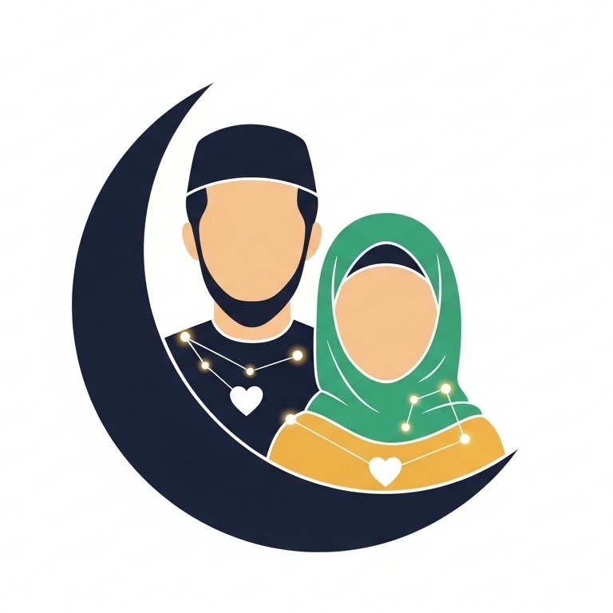

  

<h1 align="center">Azmi</h1>

<strong>Software Engineer at WAHDAH.com</strong>

Laravel applications · Production computer vision · AI products

  <a href="#-engineering-at-wahdah">Engineering</a> ·
  <a href="#-projects-i-founded">Projects</a> ·
  <a href="#-tech-stack">Tech Stack</a> ·
  <a href="https://www.linkedin.com/in/azmi03/">LinkedIn</a>

---

## 👋 About Me

I’m Azmi, a software engineer who builds web applications and applied AI systems. At **WAHDAH.com**, I work on **ONE**, a Laravel platform that connects marketplace, storefront, and operational workflows.

Before WAHDAH, I built a GPU-accelerated computer vision platform at **Infineon Technologies** to help engineers analyze semiconductor defects. Using DINOv2/DINOv3 and GPU inference on OpenShift, the system processed **40,000+ images in under 20 minutes**. Outside work, I build **AI StudyGuru** and **DeenBuddy AI**.

---

## 🛠 Engineering at WAHDAH

My work on **ONE** spans customer-facing features and the tools that staff use to run the business. One example is connecting branch stock intake to marketplace listings, so the same stock can be tracked through checkout and delivery.

- **Marketplace** · Product listings, stock reservations, checkout, payment recovery, refunds, and fulfilment.
- **Operations** · Branch and warehouse inventory, supplier management, customer-service workflows, and role-based access.
- **Otozone storefront** · Customer sign-in, account management, and storefront and delivery settings by market.

---

## 🚀 Projects I Founded

###  [AI StudyGuru](https://www.aistudyguru.com/)

An AI-powered assessment platform that helps educators turn teaching materials into quizzes aligned with **Bloom’s Taxonomy**. Teachers can review and edit the generated questions, run a live quiz with a leaderboard, and use assessment reports to see which topics students need to revisit.

###  [DeenBuddy AI](https://www.deenbuddyai.com/)

An AI assistant for exploring Islamic questions with references to the **Quran and Sunnah**. Readers can ask about topics such as tafsir, hadith, and fiqh, follow the cited sources, and build on what they learn through interactive quizzes.

---

## 💡 What I Bring

- **Full-stack product development** · I build across backend logic, data models, and the interfaces customers and support teams use.
- **Commerce and operations engineering** · I connect inventory, payments, and delivery so an order can be tracked from checkout to fulfilment.
- **Applied computer vision** · I’ve built image analysis and similarity search for semiconductor defect workflows using PyTorch and DINO Vision Transformers.
- **Production AI deployment** · I’ve deployed GPU inference on OpenShift and used KEDA to scale workers as image-processing jobs arrive.

---

## 📜 Professional Focus

I’m interested in building software where complex workflows need to feel straightforward for the people using them.

- Laravel applications, REST APIs, and internal tools
- Marketplace, inventory, and fulfilment workflows
- Computer vision, GPU inference, and MLOps
- LLM-powered learning products with assessments and source-based answers

---

## 💻 Tech Stack

<h3 align="center">Laravel &amp; Full-Stack Engineering</h3>

  
   
  Blade · Livewire · Alpine.js · PHPUnit · Playwright

<h3 align="center">AI &amp; Computer Vision</h3>

  
   
  Vision Transformers · OpenShift · KEDA

<h3 align="center">AI Product Development</h3>

  

---

## 📊 GitHub Activity

  
  

  <picture>
    <source media="(prefers-color-scheme: dark)" srcset="https://github-readme-stats.shion.dev/api?username=mohdazmi03&amp;include_all_commits=true&amp;hide_rank=true&amp;hide=issues%2Cprs&amp;disable_animations=true&amp;hide_border=true&amp;hide_title=true&amp;card_width=440&amp;theme=github_dark" />
    
  </picture>

  <picture>
    <source media="(prefers-color-scheme: dark)" srcset="https://streak-stats.demolab.com/?user=mohdazmi03&amp;hide_border=true&amp;card_width=440&amp;theme=github-dark-blue&amp;hide_current_streak=true" />
    
  </picture>

Public repository stats and activity from my GitHub contribution calendar.

---

  
  
  

